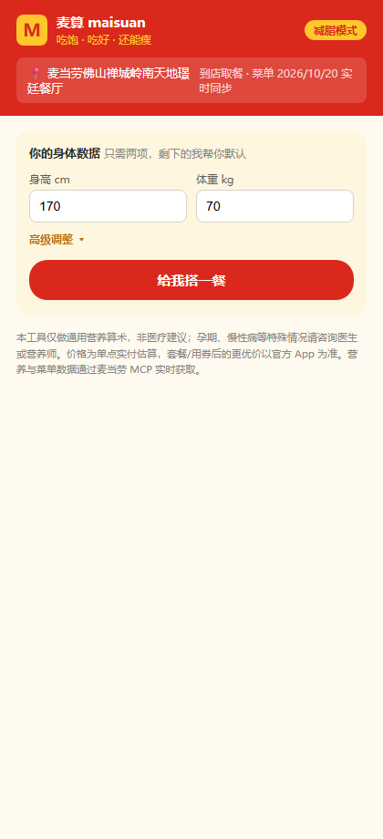
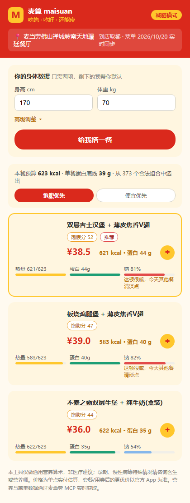
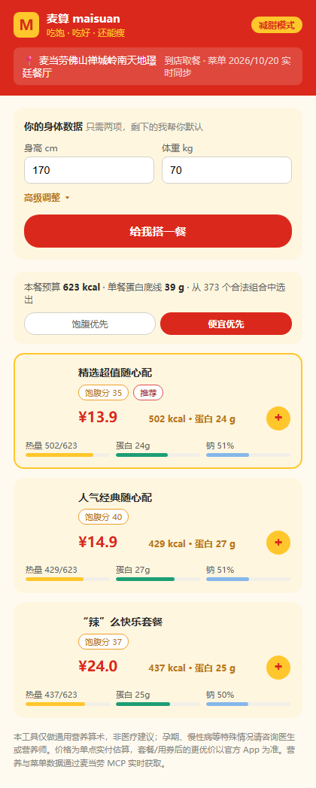

# 使用说明 · 图文版

> 网页版操作三步走：填数据 → 看推荐 → 一键下单。全程不超过 30 秒。
> **在线体验（免安装）：https://maisuan-mcd.app.workbuddy.host/?sharecode=MUGMZUYC3K**

## 第一步：填身体数据

打开页面，只需填**身高、体重**两项，其余（年龄 30 / 男 / 减脂 / 偶尔运动）自动取默认值。有特殊需求点「高级调整」展开：

- **目标**：减脂（默认，热量赤字 20%）或维持
- **活动量**：久坐 / 偶尔运动 / 常运动，影响热量预算
- **这顿预算**：填了就是硬约束，推荐绝不会超过它

## 第二步：看推荐

点「给我搭一餐」，系统从 **370+ 个合法组合**里实时算出 Top3。每张卡片告诉你四件事：

| 指标 | 含义 |
|---|---|
| 热量 | 对比你的本餐预算（黄色进度条，贴满=刚好达标） |
| 蛋白质 | 减脂保肌的关键，越高越抗饿 |
| 钠 | 占每日 2000mg 建议的比例；>60% 标橙「有点咸」，≥78% 标红——工具不会为了推荐隐瞒 |
| 价格 | 官方接口实算的单点价 |

### 饱腹优先 vs 便宜优先

顶部一键切换，**同一套数据两个视角**：

- **饱腹优先**：蛋白最高、最顶饱的组合（适合练后/怕饿）
- **便宜优先**：价格从低到高，官方折扣套餐（如 ¥13.9 随心配）会自然排到前面——这是单点凑不出来的真实便宜

### 三个贴心规则

1. **不会只推荐一个干汉堡**——单主食会自动配上全池最便宜的低卡饮料（预算不够则不强塞，绝不偷偷超预算）
2. **预算 25 就是 25**——所有推荐严格 ≤ 预算，一条都不会超
3. **新品没营养数据就不推**——菜单来自官方接口，营养库覆盖不到的当季新品自动排除，不瞎编数字

## 第三步：去下单

点卡片右下角的黄色「+」（和官方 App 的加购按钮同款）：
- 套餐清单**自动复制到剪贴板**
- 打开麦当劳官方渠道，粘贴搜索即可按官方流程下单

> 为什么不直接代下单：下单需要你的麦当劳会员登录态和支付确认，本工具不触碰账户与支付，复制跳转零风险。

## 其他打开方式

- **WorkBuddy Skill**：在 WorkBuddy 对话里说「帮我搭一餐」，对话式完成
- **命令行**：`node cli.js --height 170 --weight 70 --budget 25 --cheap`

## 免责声明

本工具仅做通用营养算术，**非医疗建议**；孕期、慢性病等特殊情况请咨询医生或营养师。商品图经麦当劳官方接口运行时加载（截图中已遮蔽），版权归金拱门（中国）所有。
